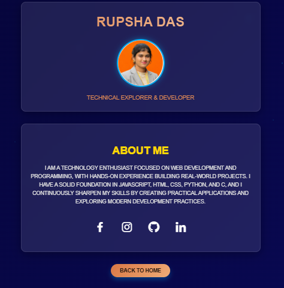
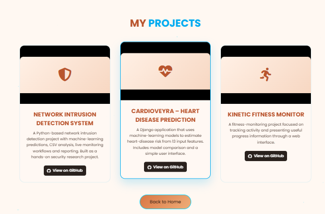
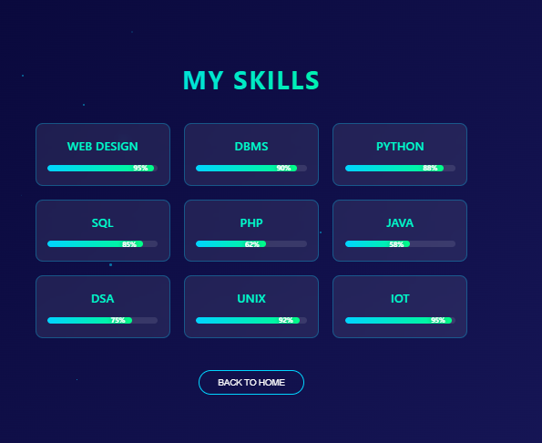
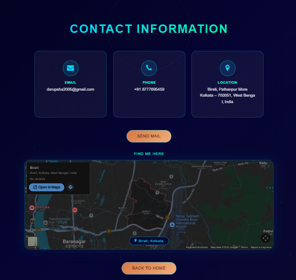

# Rupsha Das | Personal Portfolio

**BCA Student | Aspiring Software Developer | Cybersecurity Enthusiast**

A collection of my development projects, technical skills, education and professional experience.

🌐 **[Visit My Live Portfolio](https://glittering-longma-83608c.netlify.app)**

## Portfolio Screenshots

### 1. Home

### 2. About Me

### 3. Projects

### 4. Technical Skills

### 5. Contact

## Featured Projects

- [Network Intrusion Detection System](https://github.com/itsrupsha/Intrusion_Live_Research_Project)
- [CardioVeyra – Heart Disease Prediction](https://github.com/itsrupsha/CardioVeyra)
- [Kinetic Fitness Monitor](https://github.com/itsrupsha/Kinetic-Fitness-Monitor)

## Technologies

Python | JavaScript | HTML | CSS | Django | Flask | MySQL | Machine Learning | Git

## Contact

- Email: dsrupsha2005@gmail.com
- LinkedIn: [Rupsha Das](https://www.linkedin.com/in/rupsha-das-430bbb285/)
- GitHub: [itsrupsha](https://github.com/itsrupsha)

---

**Designed and developed by Rupsha Das.**
